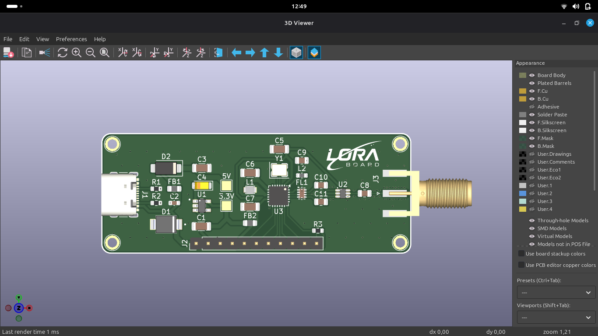
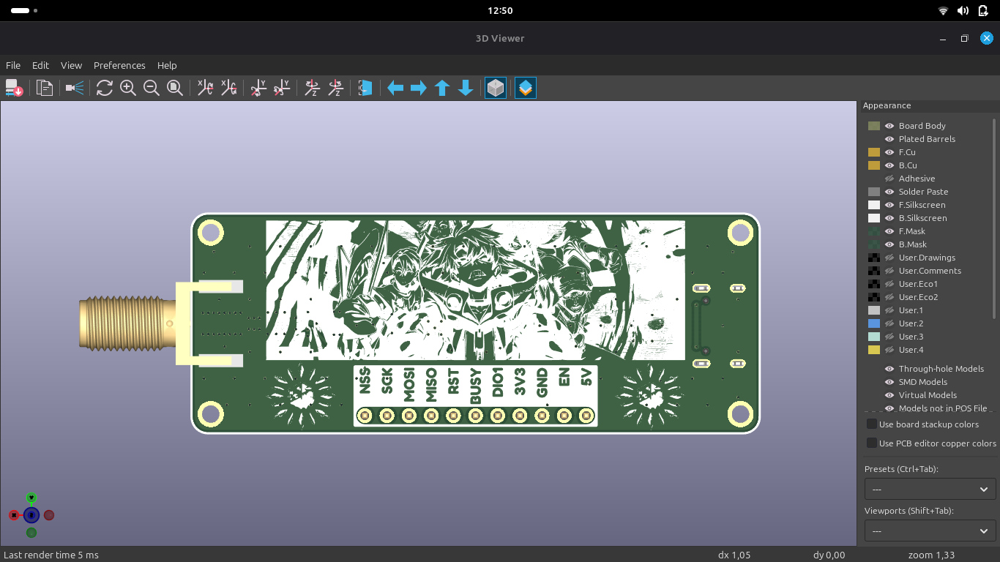
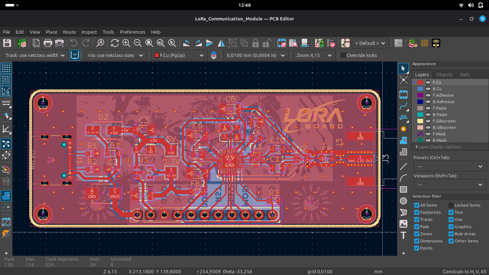
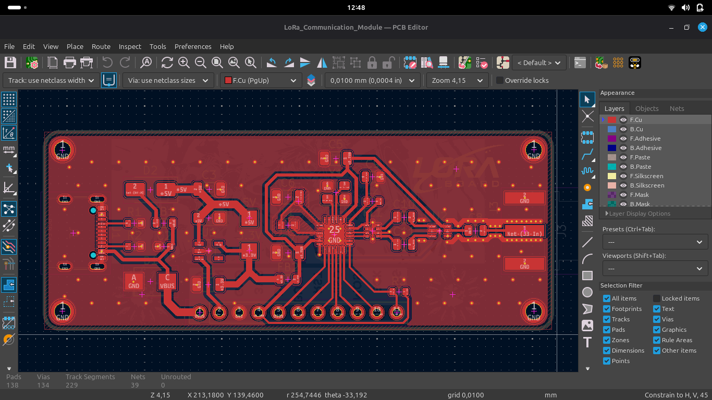
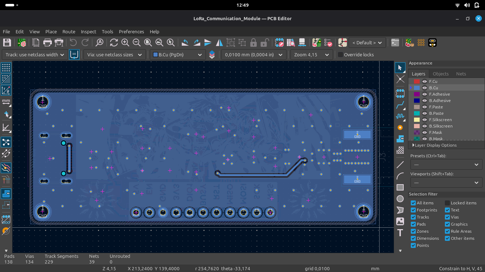
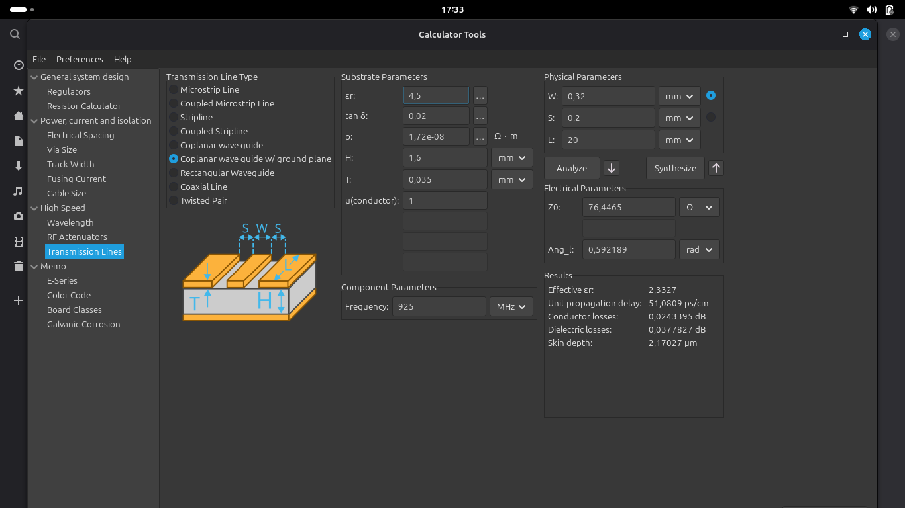
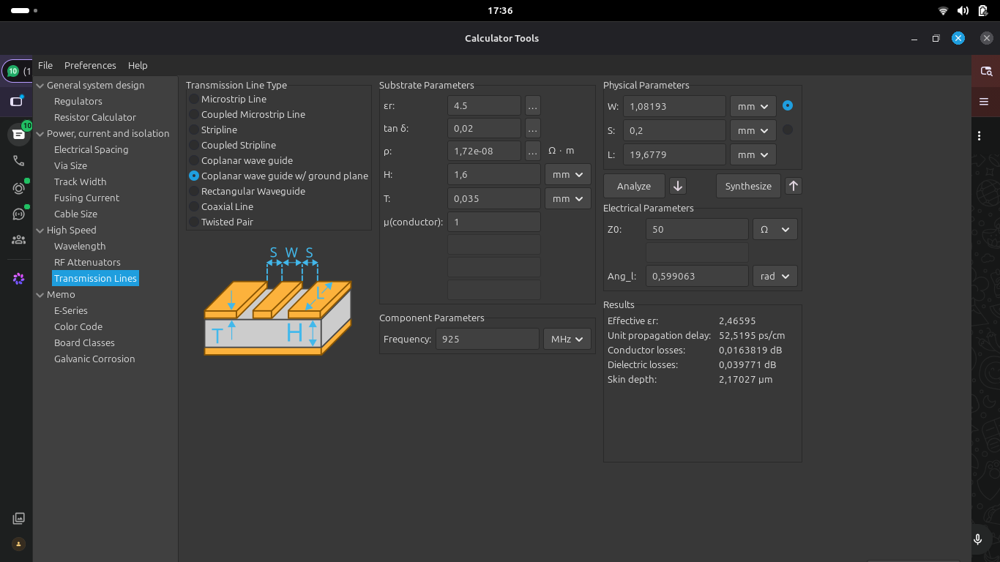
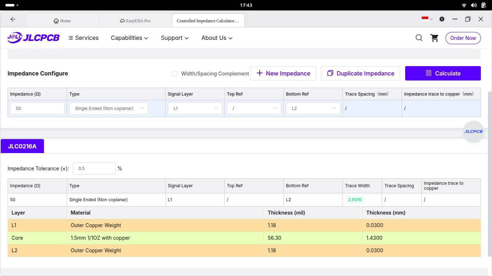

# LoRa Communication Module — Gen 1 (`LoRa_Node_Gen1`)

-orange)

-green)
-lightgrey)

A **70 × 20 mm** 2-layer sub-GHz RF prototype module built around the **Semtech SX1262** transceiver. Developed as a baseline laboratory validation platform to verify ultra-low-noise power regulation, IPD harmonic filtering, automatic RF path switching, and 50 Ω transmission-line behavior under Indonesian spectrum regulations (**920–923 MHz / AS923-2**) prior to migrating to the 4-layer **LoRa Node Gen 2** and **Dual-Channel LoRaWAN Gateway** architectures.

> **Full Engineering Documentation:** For complete mathematical derivations, regulatory references, and detailed layout analysis, read the full report in [`REPORTS/LoRa_Node_Gen1_Technical_Report.docx`](REPORTS/LoRa_Node_Gen1_Technical_Report.docx) along with the schematic exports (`LoRa_Communication_Module.pdf` & `.svg`) inside [`REPORTS/`](REPORTS/).

---

## Hardware & PCB Specifications

| Parameter | Specification |
| :--- | :--- |
| **Project Name** | LoRa Communication Module (`LoRa_Node Gen 1` — Rev 1) |
| **Designer** | Maulana Farizki (`Kelepon_goreng`) |
| **EDA Software** | KiCad E.D.A. 10.0.8 |
| **Board Dimensions** | 70 × 20 mm (138 pads, 134 vias, 229 track segments, 39 nets, 0 unrouted) |
| **PCB Stack-up** | JLCPCB `JLC0216A` — 2-Layer FR-4, 1.6 mm thickness, $\varepsilon_r = 4.5$, 1 oz (0.035 mm) copper |
| **RF Transceiver** | Semtech `SX1262` (Internal DC-DC buck enabled, 32 MHz crystal `Y1`) |
| **RF Front-End** | Johanson `0900FM15K0039` IPD Balun/Harmonic Filter + Peregrine `PE4259` SPDT Switch |
| **Power Architecture** | USB-C 5 V Sink (`5.1 kΩ` CC1/CC2) → `TPS7A2033PDBVR` Ultra-Low-Noise LDO (~7 µVᵣₘₛ) |
| **Status** | Laboratory Validation Prototype — Superseded by 4-Layer Gen 2 Architecture |

---

## 3D Renders & PCB Layout

| Top View (Component & RF Path) | Bottom View (11-Pin Header & Ground Stitching) |
| :---: | :---: |
|  |  |

| Complete PCB Layout (`F.Cu` + `B.Cu`) | Top Copper (`F.Cu`) | Bottom Ground Plane (`B.Cu`) |
| :---: | :---: | :---: |
|  |  |  |

---

## Indonesian Spectrum Compliance (Komdigi)

Designed to operate within Indonesian Short-Range Device (SRD) / Class Licence regulations (**Permenkominfo No. 2 of 2023** & **Kepmenkominfo No. 260 of 2024**):

* **Authorized Frequency Band:** `920–923 MHz` (LoRaWAN Regional Parameter **`AS923-2`**).
* **Transmit Power Limit:** End-device operated at `14–20 dBm` conducted (strictly below the `400 mW / 26.02 dBm` EIRP ceiling, subject to duty-cycle and Listen-Before-Talk rules).
* **Restricted/Prohibited Bands:** `868 MHz` (EU) and `915 MHz` (US) are avoided due to cellular spectrum overlap; `433.05–434.79 MHz` is capped at `16.4 mW` (`12.15 dBm`).

---

## System Architecture

### 1. Ultra-Low-Noise Power Supply (`USB-C` → `+3.3V` / `+3.3VA`)
Because the SX1262 receiver sensitivity reaches **$-148\ \text{dBm}$**, supply ripple directly impacts PLL phase noise:
* **USB-C Input & Protection (`J1`):** 16-pin USB 2.0 Type-C receptacle with dual `5.1 kΩ` CC pull-down resistors (`R1`, `R2`), `SMBJ5.0A` TVS diode (`D1`), `100 nF` decoupling (`C2`), ferrite bead (`FB1`), and `SS34` Schottky diode (`D2`) to prevent back-feeding from the header `+5V` pin.
* **LDO Regulation (`U1`):** `TPS7A2033PDBVR` delivers a clean `3.3 V` rail ($\approx 7\ \mu\text{V}_{\text{rms}}$ noise, high PSRR) with hardware shutdown exposed via `ENABLE_LDO` and stabilized by `10 µF` ceramic (`C1`, `C3`) and `10 µF` tantalum (`C4`) capacitors.
* **RF Rail Isolation (`+3.3VA`):** Filtered through ferrite bead `FB2` and dual `10 µF` bypass capacitors (`C5`, `C7`) to isolate SX1262 analog/RF supplies (`VDD_IN`, `VBAT`, `VBAT_IO`) and the `PE4259` switch from digital switching noise.

### 2. RF Front-End & Automatic TX/RX Switching
* **Internal Buck & PA Bias:** Internal DC-DC converter enabled via a `15 µH` inductor (`L1`) and `470 nF` capacitor (`C6`) between `DCC_SW` and `VREG` (halving RX current vs. internal LDO mode). `VR_PA` is RF-shunted by `100 nF` (`C9`) and feeds `RFO_TX` through a `27 nH` RF choke (`L2`).
* **Harmonic Filter & Balun (`FL1`):** Johanson `0900FM15K0039` IPD performs single-ended TX / differential RX (`RFI_N`, `RFI_P`) matching for `868–928 MHz` while attenuating 2nd ($\approx 1.846\ \text{GHz}$) and 3rd ($\approx 2.769\ \text{GHz}$) harmonics.
* **DC Blocking & Switching (`U2`):** Three series `47 pF` capacitors (`C10`, `C11`, `C8`) provide DC isolation with negligible insertion loss ($X_C \approx 3.67\ \Omega$ at $923\ \text{MHz}$). The `PE4259` SPDT switch is driven directly by SX1262 `DIO2` for autonomous TX/RX antenna routing.

### 3. Expansion Header Pinout (`J2` — 11-Pin 2.54 mm)
| Pin | Signal | Function | Pin | Signal | Function |
| :---: | :--- | :--- | :---: | :--- | :--- |
| **1** | `5V` (`VBUS`) | 5 V Power Input / Output | **7** | `RST` (`RESET_LoRa`) | SX1262 Active-Low Reset |
| **2** | `EN` (`ENABLE_LDO`) | LDO Hardware Enable | **8** | `MISO` | SPI Master-In Slave-Out |
| **3** | `GND` | Ground Reference | **9** | `MOSI` | SPI Master-Out Slave-In |
| **4** | `3V3` (`+3.3VA`) | Regulated 3.3 V Rail | **10** | `SCK` | SPI Serial Clock |
| **5** | `DIO1` | SX1262 Configurable IRQ | **11** | `NSS` | SPI Chip Select (Active-Low) |
| **6** | `BUSY` (`BUSY_LoRa`) | SX1262 Status Indicator | — | — | — |

---

## 50 Ω RF Impedance Analysis (2-Layer Stack-up Evaluation)

Evaluated at $f = 925\ \text{MHz}$ on JLCPCB `JLC0216A` ($\varepsilon_r = 4.5$, $H = 1.6\ \text{mm}$, $T = 0.035\ \text{mm}$):

| Analysis Scenario | Transmission Line Type | Trace Width $W$ | Gap $S$ | Dielectric $H$ | Impedance $Z_0$ | Engineering Verdict |
| :--- | :--- | :---: | :---: | :---: | :---: | :--- |
| **Actual Gen-1 Layout** | CPWG w/ ground plane | `0.32 mm` | `0.20 mm` | `1.60 mm` | **`76.45 Ω`** | Mismatch (too high) |
| **Target 50 Ω CPWG** | CPWG w/ ground plane | `1.08 mm` | `0.20 mm` | `1.60 mm` | **`50.00 Ω`** | Too wide for 0402/PE4259 pads |
| **JLCPCB Microstrip** | Single-ended microstrip | `2.69 mm` | — | `1.43 mm` | **`50.00 Ω`** | Impractical on compact RF pads |

| Actual Gen-1 Impedance (`76.45 Ω`) | Synthesized 50 Ω CPWG (`1.08 mm`) | JLCPCB 2-Layer Reference (`2.69 mm`) |
| :---: | :---: | :---: |
|  |  |  |

**Key Takeaway:** Achieving $50\ \Omega$ on a $1.6\ \text{mm}$ 2-layer FR-4 core forces wide traces ($1.08\text{–}2.69\ \text{mm}$) that create severe capacitive discontinuities at 0402 passive pads and the `PE4259` SC-70 pins. Migrating to a **4-layer stack-up** ($H \approx 0.20\ \text{mm}$ prepreg) resolves this by allowing a $\approx 0.34\ \text{mm}$ $50\ \Omega$ CPWG trace.

---

## Errata & Lessons Applied to Gen 2

| Code | Subsystem | Issue Description | Gen-1 Lab Workaround | Permanent Fix in Gen 2 |
| :--- | :--- | :--- | :--- | :--- |
| **`ERR-01`** | RF Transmission Line | Characteristic impedance $Z_0 \approx 76.45\ \Omega$ (vs. $50\ \Omega$ target) due to $1.6\ \text{mm}$ 2-layer stack-up. | Restricted to short-range bench validation only. | Migrated to 4-layer stack-up with internal ground plane ($H \approx 0.20\ \text{mm}$). |
| **`ERR-02`** | LDO Output (`C4`) | Tantalum capacitor footprint polarity inverted relative to schematic symbol. | Manually rotated `C4` by 180° during assembly. | Corrected footprint silkscreen/courtyard polarity + strict DRC rules. |

---

## Repository Structure

```text
LoRa_Node_Gen1-/
├── README.md                  # Project overview, specifications, and engineering summary
├── REPORTS/                   # Full Technical Report (.docx) and schematic exports (.pdf, .svg)
├── DOCUMENTATION/             # 3D renders, copper layer captures, and impedance calculator screenshots
└── DATASHEETS/                # Reference datasheets (SX1262, 0900FM15K0039, PE4259, TPS7A20)
